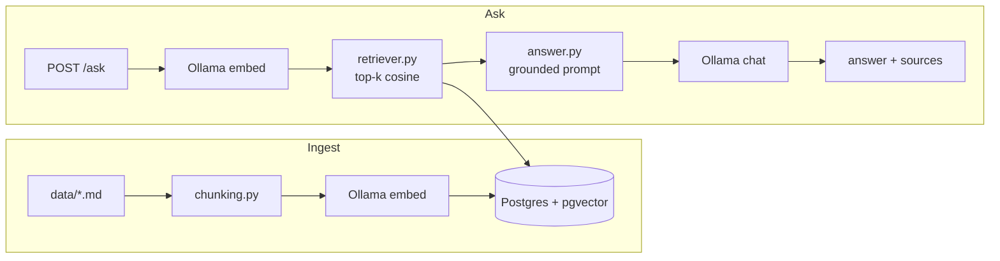

# docs-rag

A small retrieval-augmented generation (RAG) prototype: ask questions about a set of Markdown
docs and get an answer with source references. It says "I don't know" when the docs do not
contain the answer.

## Architecture



| File | Job |
|---|---|
| `src/docs_rag/chunking.py` | split text into overlapping chunks |
| `src/docs_rag/ingest.py` | CLI: read `data/`, chunk, embed, store |
| `src/docs_rag/store.py` | pgvector table, insert, cosine search |
| `src/docs_rag/llm.py` | Ollama HTTP client (embed, chat) |
| `src/docs_rag/retriever.py` | embed question, return top-k chunks |
| `src/docs_rag/answer.py` | prompt, LLM call, sources, "no answer" |
| `src/docs_rag/api.py` | FastAPI: `POST /ask`, `GET /health` |
| `src/docs_rag/lc_chain.py` | the same chain written with LangChain |
| `scripts/evaluate.py` | hit@k evaluation |

## Setup

Requirements: Docker, [uv](https://docs.astral.sh/uv/), make.

```bash
cp .env.example .env     # optional, defaults already match
make up                  # postgres+pgvector and Ollama in Docker, pulls the two models
make ingest              # chunk + embed everything in ./data
make eval                # writes eval/results.md
make ask Q="Who has to approve a hotfix?"
uv run uvicorn docs_rag.api:app   # start the API on :8000
make test lint
```

Ollama runs as a container (`docker-compose.yml`), so nothing needs installing on the host.
On a machine with GPU or a native Ollama, set `OLLAMA_BASE_URL` and skip the container.
The first `make up` downloads about 2.3 GB of models.

### Example requests

```bash
curl localhost:8000/health
# {"status":"ok"}

curl -s localhost:8000/ask -H 'content-type: application/json' \
  -d '{"question": "Who has to approve a hotfix?"}'
# {"answer":"According to [1], a hotfix needs approval from the release manager and one member of the platform team.","sources":["notes/release-process.md"]}

curl -s localhost:8000/ask -H 'content-type: application/json' \
  -d '{"question": "Who won the 2018 world cup?"}'
# {"answer":"I don't know based on the provided documents.","sources":[]}
```

Errors: invalid input (question shorter than 3 characters, `k` outside 1..20) returns `422`
with FastAPI's validation details. If Ollama is unreachable the API returns `502` with a
message.

## Design decisions

- **Plain Python, no framework in the main path.** The core pipeline is a few hundred lines and every
  step is visible. A framework would hide the parts worth explaining.
- **Postgres + pgvector** instead of a dedicated vector DB: one familiar system, SQL for
  filtering later, and cosine search is one `ORDER BY embedding <=> query`. No ANN index is
  created because 262 chunks are searched exactly, which is faster and always correct.
  With more data I would add an HNSW index.
- **Ollama for both embeddings and chat**, so the project runs offline and free. Models are
  configurable by environment variable: `nomic-embed-text` (768 dimensions, small, good
  quality for its size) and `llama3.2:3b` (fits on a laptop CPU; temperature 0).
- **Character-based chunking**, 800 characters with 150 overlap, cutting at paragraph, line
  or word boundaries. Simple and predictable. A Markdown-aware splitter (by heading) would
  keep sections intact; see "What I would do next".
- **Two guards for "no answer".** (1) Chunks below a cosine similarity of `MIN_SCORE` (0.4)
  are discarded; if nothing remains the LLM is not called at all. (2) The system prompt tells
  the model to answer with a fixed sentence when the context lacks the answer, and the code
  detects that sentence and returns no sources.
- **Sources come from citations.** The prompt asks the model to cite passages as `[n]`; only
  cited passages are returned as sources (all retrieved ones if it cites none).
- **Dependency injection by function arguments** (`retrieve_fn`, `chat_fn`, `embed`,
  `search`) rather than a DI framework. It makes the tests offline with no mocking library.
- **Python 3.15 and latest packages**, pinned through `uv.lock`.

## Assumptions

- Provider: Ollama (local, via Docker). Docker is installed; no API key is needed.
- Corpus: the English tutorial of [Typer](https://github.com/fastapi/typer) (MIT, license in
  `data/typer/LICENSE`, source commit in `data/typer/NOTICE`), plus three own notes in
  `data/notes/` (release process, on-call, code style). The notes contain fictional internal
  facts so that the model cannot know the answers from training data.
- Only English text, Markdown only, and the corpus fits in memory.
- Typer's code-include lines and console screenshots were stripped, so code samples are not
  searchable. Only the prose is.
- Embedding dimension (768) is fixed by the model; changing the model means changing
  `EMBED_DIM` and re-ingesting.

## Evaluation

`eval/questions.json` has 20 questions with the expected source file (14 on Typer, 6 on the
own notes). `make eval` retrieves the top 5 chunks per question and checks whether the
expected file is among them. Last run:

| k | hits | hit@k |
|---|------|-------|
| 1 | 19/20 | 95% |
| 3 | 20/20 | 100% |
| 5 | 20/20 | 100% |

Treat this as a smoke test, not a benchmark: 20 questions, written by me after reading the
docs, so they share vocabulary with the answers. Real user questions would score lower.
See `docs/EXPLAINED.md` for what hit@k does and does not measure.

## Plain vs. LangChain

`src/docs_rag/lc_chain.py` re-implements retrieve + answer with current LangChain packages
(`langchain-core`, `langchain-ollama`): a `BaseRetriever` subclass, `ChatPromptTemplate`,
`ChatOllama` and an LCEL chain (`prompt | llm | parser`).

| | Plain | LangChain |
|---|---|---|
| Code size | `retriever.py` + `answer.py` + `llm.py` = about 130 lines | `lc_chain.py` = about 60 lines, plus the shared `store.py` |
| Dependencies | `httpx` | many extra packages (`langchain-core`, `langsmith`, `pydantic` v2 stack, ...) |
| Control | I see every HTTP call and every prompt character | Prompt assembly, retries and parsing live inside library classes |
| Testing | Plain functions, tests inject fakes | Needs patching of `ChatOllama` or a fake LLM |
| Results | Reference | Same retrieval and prompt; same answers on the 2 questions I tried (not a systematic comparison) |

Retrieval results are identical by construction, because both versions call the same
`store.search`. I did not use `langchain-postgres`: its latest release pins `pgvector<0.4`
and conflicts with the current `pgvector` client. The LangChain version is shorter, but I
would keep the plain version here: the saved lines are the easy ones, and the dependency cost
is large for a pipeline this small. LangChain pays off with many providers, agents or tools.

## Limitations

- Retrieval quality depends on one small embedding model; no reranker, no hybrid (keyword)
  search.
- A 3B chat model sometimes ignores instructions: it can answer from its own knowledge if
  the context is vaguely related. The similarity threshold reduces but does not remove this.
- `MIN_SCORE` is a hand-picked constant. It is not calibrated against data.
- Chunking ignores Markdown structure and may split code blocks or tables.
- Evaluation measures retrieval only, not answer correctness or faithfulness.
- Ingest drops and rebuilds the whole table, so there is no incremental update.
- No authentication, rate limiting or streaming on the API.

## What I would do next

1. Split by Markdown headings first, then by size, and store the heading path as metadata.
2. Add an HNSW index and hybrid search (BM25 + vectors) with reciprocal rank fusion.
3. Extend the evaluation with answer checks (LLM-as-judge or string match) and negative
   questions that must return "no answer"; tune `MIN_SCORE` on them.
4. Incremental ingest keyed by file hash.
5. Stream the answer and add a simple web UI.
6. Add a reranker for the top 20 candidates.
